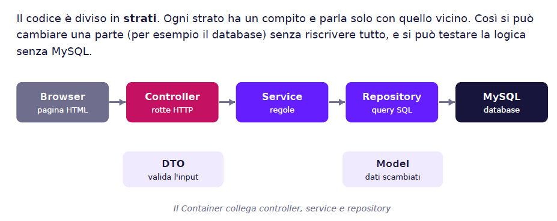
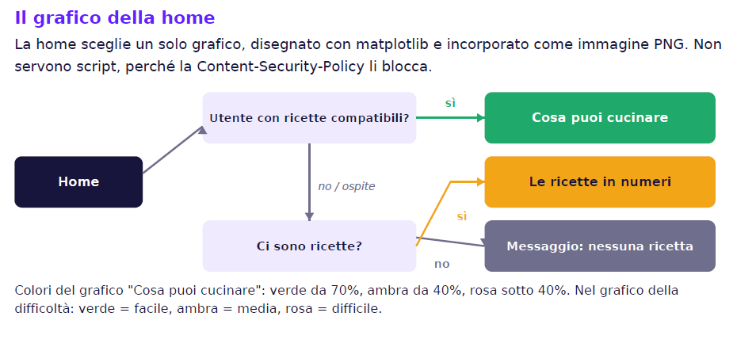
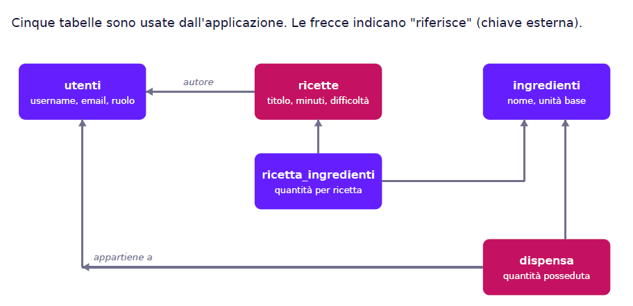

# Dispensa & Ricette

Applicazione web in **Flask** che risponde a una domanda semplice: *"Cosa cucino con quello che ho in casa?"*

L'utente segna gli ingredienti che ha in dispensa (con le quantità) e l'app:

- ordina le ricette per **percentuale di ingredienti già disponibili**;
- mostra per ogni ricetta **cosa manca** e genera la **lista della spesa in CSV**;
- permette di **scalare le quantità** in base al numero di porzioni.

---

## Funzionalità

| Area | Cosa fa |
|---|---|
| Account | Registrazione con login automatico, login con username **o** email, logout, pagina profilo |
| Ricette | Elenco paginato (9 per pagina) con ricerca testuale, filtro per difficoltà e per tempo massimo; dettaglio con porzioni modificabili; creazione, modifica ed eliminazione |
| Ingredienti | Catalogo condiviso; ogni utente loggato può aggiungerne di nuovi (nome univoco, unità `g`, `ml` o `pz`) |
| Dispensa | Ogni utente ha la sua dispensa personale: imposta o aggiorna la quantità di un ingrediente, rimuovilo |
| Cosa cucino? | Ricette ordinate per copertura degli ingredienti (100% = puoi farla adesso) |
| Lista della spesa | Download CSV con solo gli ingredienti che mancano, per le porzioni scelte |
| Home | Grafico statistico (vedi sotto) |

## Architettura del sistema

Ecco una panoramica visiva dell'architettura a layer dell'applicazione:



### Il grafico della home

La home mostra un solo grafico, scelto così:

1. **Utente loggato con almeno una ricetta compatibile con la dispensa** → barre "Cosa puoi cucinare" (le prime 5 ricette, colorate in base alla percentuale: verde ≥ 70%, ambra ≥ 40%, rosa sotto).
2. **Ospite, oppure dispensa vuota o senza corrispondenze** → barre "Le ricette in numeri" (quante ricette facili, medie, difficili).
3. **Nessuna ricetta nel database** → messaggio "Non ci sono ancora ricette".

I grafici sono disegnati con matplotlib e incorporati nella pagina come immagine PNG (data URI): la Content-Security-Policy del sito blocca script e stili inline, quindi non serve JavaScript.

---

## Quanti dati servono perché funzioni?

### Esempio di Grafico Statistico

Ecco un esempio del rendering grafico generato da Matplotlib e integrato dinamicamente nella home:



---

Non esiste un numero minimo di ricette, ma alcune funzioni hanno dei prerequisiti:

- **Ricette ≥ 1**: serve perché compaia il link "Ricette" nella navbar e perché la home mostri un grafico.
- **Ingredienti ≥ 1**: servono per creare una ricetta (ogni ricetta ha almeno un ingrediente, scelto dal catalogo).
- **"Cosa cucino?"** mostra una ricetta solo se hai in dispensa **almeno un suo ingrediente in quantità sufficiente**. Senza corrispondenze la lista è vuota.

Il file `sql/03_seed.sql` inserisce il catalogo completo degli ingredienti e **100 ricette di esempio** (associate automaticamente all'utente `admin` tramite gli script di supporto), così l'app non parte vuota.

---

## Requisiti

- Python 3.10 o superiore (il codice usa la sintassi `dict[str, Any] | None`)
- MySQL 8.0.19 o superiore (la query della dispensa usa `INSERT ... AS nuovo ON DUPLICATE KEY UPDATE`)

---

## Installazione

```bash
# 1. ambiente virtuale
python -m venv .venv
.venv\Scripts\activate          # Windows
source .venv/bin/activate       # macOS / Linux

# 2. dipendenze
pip install -r requirements.txt
```

> **Attenzione:** il `requirements.txt` attuale non elenca tutti i pacchetti che il codice importa. Se all'avvio vedi `ModuleNotFoundError`, installa anche:
>
> ```bash
> pip install "pydantic[email]" python-dotenv matplotlib
> ```
>
> poi rigenera il file con `pip freeze > requirements.txt`.

### Configurazione

Copia `.env.example` in `.env` e compila i valori:

```bash
cp .env.example .env
```

| Variabile | Significato | Default |
|---|---|---|
| `DB_HOST` | Host MySQL | `127.0.0.1` |
| `DB_PORT` | Porta MySQL | `3306` |
| `DB_USER` | Utente MySQL | — |
| `DB_PASSWORD` | Password MySQL | — |
| `DB_NAME` | Nome del database (solo lettere, numeri, underscore) | **obbligatorio** |
| `SECRET_KEY` | Chiave per sessioni e CSRF | **obbligatoria** |
| `SESSION_COOKIE_SECURE` | `true` in produzione (HTTPS) | `false` |
| `FLASK_DEBUG` | `1` per il debug | `0` |
| `LOG_LEVEL` | Livello dei log | `INFO` |
| `LOG_DIR` | Cartella dei log | `logs` |

Genera una `SECRET_KEY` casuale con:

```bash
python -c "import secrets; print(secrets.token_hex(32))"
```

### Database

All'avvio l'app **crea da sola** il database e le tabelle (`sql/02_schema.sql`), se mancano. L'utente MySQL deve quindi avere il permesso `CREATE`.

I dati di esempio vanno caricati a mano, **una sola volta**:

```bash
mysql -u ricette_user -p < sql/03_seed.sql
```

> Il file contiene `USE ricette_db;`: se hai scelto un altro `DB_NAME`, modifica quella riga. Le ricette di esempio non sono idempotenti: rieseguire lo script le duplica.

### Avvio

```bash
python run.py
```

Con `FLASK_DEBUG=1` nel `.env` parte in modalità debug. Apri <http://127.0.0.1:5000>.

### Creare un amministratore

La registrazione crea sempre utenti con ruolo `utente`. Per promuovere un account:

```sql
UPDATE utenti SET ruolo = 'admin' WHERE username = 'il_tuo_username';
```

Un admin può modificare ed eliminare **tutte** le ricette. Le ricette di esempio hanno `utente_id = NULL`, quindi solo un admin può modificarle.

---

## Struttura del progetto

```
ricette_app/
├── run.py                  # punto di ingresso
├── requirements.txt        # dipendenze di produzione
├── requirements-dev.txt    # + pytest
├── pytest.ini
├── .env.example
├── 01_esegui_admin_sql.py  # script di utility per creare l'admin e associare le ricette
├── 02_esegui_seed.py       # script avanzato per il seed automatico con l'admin
├── docs/
│   ├── architettura.png    # diagramma architetturale
│   ├── database.png        # schema ER del database
│   └── graffico.png        # esempio di grafico generato
├── sql/
│   ├── 02_schema.sql       # tabelle (eseguito all'avvio)
│   └── 03_seed.sql         # dati di esempio
├── tests/
│   ├── conftest.py         # fixture: repository finti, service, app Flask
│   ├── fakes.py            # repository in memoria (niente MySQL)
│   ├── unit/
│   └── integration/
└── app/
    ├── __init__.py         # factory create_app()
    ├── config.py           # configurazione da .env
    ├── container.py        # collegamento manuale delle dipendenze
    ├── db.py               # connessione MySQL (una per richiesta)
    ├── extensions.py       # CSRF e rate limiter
    ├── logging_config.py   # log JSON con rotazione
    ├── controllers/        # rotte HTTP (blueprint)
    ├── dto/                # validazione dei dati in ingresso (pydantic)
    ├── models/             # dataclass scambiate tra repository e service
    ├── repositories/       # solo SQL parametrizzato
    ├── service_interface/  # contratti (classi astratte)
    ├── service_impl/       # regole di business
    ├── exceptions/         # eccezioni applicative e handler globale
    ├── templates/          # pagine Jinja2
    ├── static/             # CSS, JS, immagini
    └── utils/              # grafici, filtri, decorator
```


### Inizializzazione Database, Account Admin e Seed

Per far funzionare l'applicazione con il catalogo completo e le ricette predefinite, **l'utente `admin` deve essere creato prima (o contemporaneamente) all'inserimento delle ricette**, in modo che ogni ricetta del seed venga correttamente associata a un proprietario reale nel database.

La password dell'admin (`Admin_123`) viene cifrata in sicurezza utilizzando **Argon2id**. Per generare manualmente l'hash da terminale VS Code / PowerShell / Bash puoi eseguire:

```bash
python -c "from argon2 import PasswordHasher; print(PasswordHasher().hash('Admin_123'))"
```

### Architettura a strati

```
Browser → Controller → Service → Repository → MySQL
              │            │
              └── DTO ─────┘   (dati validati in ingresso)
```

- **Controller**: legge la richiesta, chiama il service, restituisce la pagina. Nessuna regola di business.
- **DTO**: valida e normalizza i dati del modulo (es. `"150,5"` diventa `Decimal("150.5")`) prima che arrivino al service.
- **Service**: applica le regole (permessi, esistenza degli ingredienti, calcolo delle porzioni).
- **Repository**: contiene solo query SQL con parametri `%s`.
- **Container**: crea repository e service e li collega tra loro, senza framework di iniezione.

---

## Rotte principali

| Metodo | Percorso | Login | Descrizione |
|---|---|:-:|---|
| GET | `/` | no | Home con grafico |
| GET | `/profilo` | sì | Profilo utente |
| GET, POST | `/auth/registrati` | no | Registrazione (max 10 POST/ora) |
| GET, POST | `/auth/login` | no | Login (max 5 POST/minuto) |
| POST | `/auth/logout` | no | Logout |
| GET | `/ricette` | no | Elenco, parametri `q`, `difficolta`, `max_minuti`, `pagina` |
| GET | `/ricette/<id>` | no | Dettaglio, parametro `porzioni` |
| GET, POST | `/ricette/nuova` | sì | Crea ricetta |
| GET, POST | `/ricette/<id>/modifica` | sì | Modifica (autore o admin) |
| POST | `/ricette/<id>/elimina` | sì | Elimina (autore o admin) |
| GET, POST | `/ingredienti/nuovo` | sì | Aggiungi ingrediente al catalogo |
| GET | `/dispensa` | sì | La mia dispensa |
| POST | `/dispensa/imposta` | sì | Imposta quantità |
| POST | `/dispensa/<id>/rimuovi` | sì | Rimuovi ingrediente |
| GET | `/dispensa/cosa-cucinare` | sì | Ricette cucinabili |
| GET | `/dispensa/spesa/<id>.csv` | sì | Lista della spesa |

---

## Database

```
utenti ──< ricette ──< ricetta_ingredienti >── ingredienti >── dispensa >── utenti
```


| Tabella | Contenuto |
|---|---|
| `utenti` | username, email, hash della password, ruolo (`utente` / `admin`) |
| `ingredienti` | nome univoco, unità base (`g`, `ml`, `pz`) |
| `ricette` | titolo, descrizione, istruzioni, porzioni, minuti, difficoltà; `utente_id` nullo se l'autore viene eliminato |
| `ricetta_ingredienti` | quantità di ogni ingrediente per ricetta (chiave composta) |
| `dispensa` | quantità posseduta da ogni utente (chiave composta) |
| `preferiti`, `piano_pasti` | **create dallo schema ma non ancora usate dal codice** |

Cancellando una ricetta spariscono le sue righe; un ingrediente usato in una ricetta non si può eliminare (`ON DELETE RESTRICT`).

### Come si calcola la percentuale di "Cosa cucino?"

Per ogni ricetta la query conta gli ingredienti totali e quelli per cui `dispensa.quantita >= ricetta_ingredienti.quantita`. La percentuale è `posseduti / totale`. Le ricette con 0 ingredienti posseduti sono escluse; a parità di percentuale vengono prima quelle con meno ingredienti.

---

## Sicurezza

- Password salvate con **Argon2id**; il login non rivela se esiste lo username (stesso messaggio e tempi equalizzati con un hash finto).
- **CSRF** attivo su tutti i moduli (Flask-WTF).
- **Rate limiting** su login e registrazione (Flask-Limiter, in memoria).
- Cookie di sessione `HttpOnly`, `SameSite=Lax`, durata 2 ore; `Secure` e HSTS attivabili con `SESSION_COOKIE_SECURE=true`.
- Rigenerazione della sessione a ogni login (anti *session fixation*).
- Header di sicurezza: Content-Security-Policy, `X-Frame-Options`, `X-Content-Type-Options`, `Referrer-Policy`.
- Query SQL sempre parametrizzate; `LIKE` con escape dei caratteri speciali.
- Export CSV protetto dalla *CSV injection* (le celle che iniziano con `= + - @` vengono prefissate).
- Un utente modifica solo le proprie ricette, a meno che sia admin.

## Log

Un evento per riga in formato JSON, su console e in `logs/app.log` (rotazione a 5 MB, 5 file). Ogni riga include `request_id`, IP, metodo, percorso e `utente_id`. Le query string non vengono mai registrate. Per disattivare il file: `LOG_TO_FILE=false`.

---

## Test

```bash
pip install -r requirements-dev.txt
pytest
```

I test **non richiedono MySQL**: `tests/fakes.py` fornisce repository in memoria e `conftest.py` li collega ai service veri. Si distinguono:

- **test dei service e dei DTO**: regole di business e validazione (password, quantità con la virgola, ingredienti duplicati, permessi, porzioni, suggerimenti, lista della spesa);
- **test di integrazione**: l'app Flask vera, con CSRF e rate limit disattivati, usata tramite il client di test.

---


## Idee per il futuro

- Integrare la gestione grafica del ruolo admin nella UI e nella navbar (es. menu a tendina o pannello di controllo dedicato), funzionalità attualmente predisposta solo a livello di database e permessi di backend.

- Usare le tabelle `preferiti` e `piano_pasti`, già presenti nello schema.

- Colorare le barre di "Cosa cucino?" in base alla difficoltà reale della ricetta.

- Rendere idempotente `03_seed.sql`.

- Passare il rate limiter da `memory://` a Redis se l'app gira su più processi.